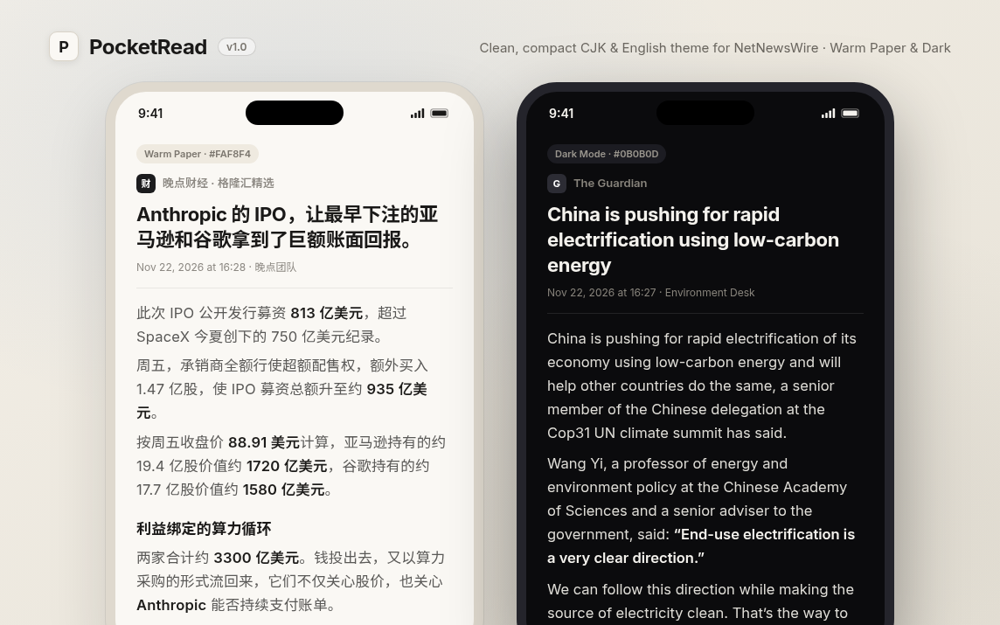

# PocketRead

干净、紧凑的 NetNewsWire 中英文阅读主题（A clean, compact CJK & English reading theme for NetNewsWire）。

- **在线预览**：[https://fishyo.github.io/pocketread-nnw-theme/](https://fishyo.github.io/pocketread-nnw-theme/)
- **一键安装**：[在 NetNewsWire 中打开](netnewswire://theme/add?url=https%3A%2F%2Fgithub.com%2Ffishyo%2Fpocketread-nnw-theme%2Freleases%2Fdownload%2Fv1.0.0%2FPocketRead.nnwtheme.zip)
- **直接下载**：[PocketRead.nnwtheme.zip (v1.0)](https://github.com/fishyo/pocketread-nnw-theme/releases/download/v1.0.0/PocketRead.nnwtheme.zip)

> 支持 iPhone、iPad 与 Mac。已在 iPhone 上测试，其他设备欢迎反馈问题或提交 PR。

## 做了哪些调整

- **顶格对齐，收紧段距**：不做首行两字缩进，统一顶格左对齐；中文段距 `0.35em`，英文段距 `0.48em`，行高 `1.64`。
- **基准字号 1.07x**：在 NetNewsWire 传入的 `[[font-size]]` 上按 `1.07` 倍微调（默认约 `18.2px`），左右留白 `22px`，仍随系统动态字体缩放。
- **正文粗体改用 Semibold 600**：把 `<b>` 和 `<strong>` 从默认 700 调为 600 半粗体，配合略深一阶的炭黑色，区分重点而不显厚重。
- **暖纸与深黑配色**：浅色用暖纸底 `#FAF8F4` 配炭灰字 `#5A5957`，深色用 `#0B0B0D` 配柔白 `#DFDDD7`，并覆盖部分源站写死的暗色内联样式（如 `#333`），避免深色模式下字迹发暗。
- **清理常见源站的多余空行**：折叠常见中文 RSS 源的空段落、连续 ` ` 与空占位容器，并兼容 `.article-paragraph` 等非标段落结构。
- **英文标题折行**：标题保持左对齐并启用 `text-wrap: pretty`，减少末行孤词。

## 手动安装

1. 从 [Releases](https://github.com/fishyo/pocketread-nnw-theme/releases/latest) 下载 `PocketRead.nnwtheme.zip` 并解压得到 `PocketRead.nnwtheme`。
2. 在 iOS / iPadOS 上通过「共享」选择 **NetNewsWire** 导入，或在 macOS 上直接双击打开。
3. 打开 NetNewsWire 设置 → **Article Theme** → 选择 **PocketRead**。

## License

[MIT](./LICENSE)
